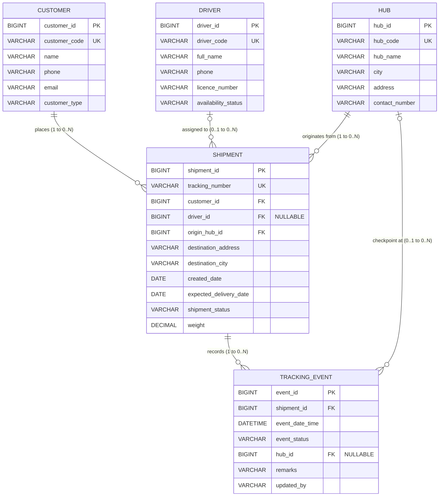

# LogiTrack — Logistics Shipment and Delivery Tracking System

<div align="center">


**Enterprise Full-Stack Logistics Operations Management & Consignment Tracking Platform**

[](https://angular.dev/)
[](https://spring.io/projects/spring-boot)
[-ED8B00?style=for-the-badge&logo=openjdk&logoColor=white)](https://openjdk.org/)
[](https://www.mysql.com/)
[](https://getbootstrap.com/)

[Overview](#1-project-overview) • [Architecture](#5-system-architecture) • [Database & ER Diagram](#6-database-design--er-diagram) • [Setup & Run](#7-setup--how-to-run) • [REST API](#8-rest-api-endpoints) • [Testing](#9-how-to-test)

</div>

---

## 1. Project Overview

**LogiTrack** is a full-stack web-based **Logistics Shipment and Delivery Tracking System** engineered with **Angular 19**, **Java Spring Boot 3.4.5**, and **MySQL 8.0 (InnoDB)**. It provides logistics coordinators, hub operators, delivery supervisors, and customer service teams with a centralized operations control tower for managing master entities, registering shipments, assigning drivers, recording manual milestone checkpoints, viewing chronological tracking timelines, and monitoring overdue deliveries.

---

## 1a. What's new — professional rebuild (November 2026)

- **Professional UI**: light + dark mode, grouped collapsible sidebar, global search,
  notifications centre, redesigned dashboard (on-time %, 14-day trend, top hubs/drivers).
- **Login**: JWT auth with demo accounts (see below); every `/api/**` endpoint except
  `/api/auth/**`, `/api/public/**` and `/actuator/health` requires a Bearer token.
- **Analytics page** (`/analytics`): 14-day trend, status mix, hub throughput, driver
  leaderboard, on-time delivery %. **Notifications page** (`/notifications`): delayed
  shipments + recent events. **Settings page** (`/settings`): theme, density, page size.
- **Public tracking** (`/track`): anyone can track a shipment by number — no login.
- **One-click shipment workflow**: assign driver, advance to the next status, cancel,
  mark delivered with proof of delivery — each appends a tracking event.
- **Pagination, sorting & CSV export** on all list endpoints (paged shape only when
  `?page=` is supplied; otherwise the original array is returned).
- **Docker**: `docker compose up --build` runs MySQL + backend + frontend with healthchecks.
- **Demo mode**: if the backend is unreachable, the UI shows clearly labelled DEMO DATA
  instead of pretending to be live. Full list: `CHANGELOG_PRO.md`.

### Demo login

| Role | Email | Password |
|---|---|---|
| Admin | `admin@logitrack.in` | `Admin@123` |
| Dispatcher | `dispatcher@logitrack.in` | `Dispatch@123` |
| Viewer (read-only UI) | `viewer@logitrack.in` | `View@123` |

Change the passwords and `JWT_SECRET` via environment variables (`.env.example`) before
any real deployment — the defaults are demo-only.

### Quick start

```bash
# Option A — Docker (recommended)
cp .env.example .env   # edit DB_PASSWORD / JWT_SECRET
docker compose up --build
# Frontend http://localhost:4200 · Backend http://localhost:8080/api

# Option B — local (JDK 21, Maven 3.9+, Node 20+, MySQL 8 with logistics_db)
bash scripts/run-all.sh            # Linux/macOS
# powershell -ExecutionPolicy Bypass -File scripts\run-all.ps1   # Windows
```

> Frontend dev server proxies `/api/*` to `http://localhost:8080` (`proxy.conf.json`).
> The production Docker image serves the Angular build with nginx and proxies `/api/`
> to the `backend` container.

---

## 2. Problem Statement

Logistics operations teams frequently rely on disconnected spreadsheets to track consignments, customer records, assigned fleet drivers, hub handoffs, and delivery milestones. Manual spreadsheet workflows make it difficult to:
- Identify overdue shipments whose expected delivery dates have passed.
- Maintain a synchronized, tamper-evident chronological tracking timeline per consignment.
- Enforce referential integrity across customers, drivers, hubs, shipments, and tracking events.

LogiTrack replaces fragmented manual spreadsheets with a strongly typed Angular UI backed by a layered Spring Boot REST API and persistent relational MySQL database.

---

## 3. Objectives

1. **Centralize Master Data**: Maintain **Customers**, **Drivers**, and **Delivery Hubs** with unique business codes, field-level validation, search/filtering, and safe deletion constraints.
2. **Manage Consignments End-to-End**: Register shipments with unique tracking numbers, customer and origin hub links, destination details, positive consignment weight, valid delivery dates, and optional driver assignment.
3. **Synchronize Manual Milestone Tracking**: Record chronological milestones (`PENDING`, `PICKED_UP`, `IN_TRANSIT`, `OUT_FOR_DELIVERY`, `DELIVERED`) with automatic parent shipment status synchronization.
4. **Enforce Audit Integrity**: Keep tracking history append-only by default, require explicit `remarks` for corrections, and prohibit deleting shipments that already have tracking history.
5. **Surface Live Operations Intelligence**: Provide a real-time Operations Dashboard displaying live backend counts, status distribution analytics, recent network activity, quick actions, and **Delayed (Overdue) Shipments** reporting.

---

## 4. Scope

### In Scope
- Full CRUD operations for the **five core persistent entities** subject to business deletion rules.
- Shipment registration, optional driver assignment/reassignment, and hub selection from live backend dropdowns.
- Chronological tracking timeline lookup (`GET /api/shipments/{trackingNumber}/timeline`) and milestone appending/correction.
- Multi-criteria shipment search and filtering (by tracking number, status, created date range, customer, driver, origin hub, and overdue status).
- Live dashboard KPIs, SVG donut status distribution chart, recent tracking activity feed, and delayed shipment alerts.
- Complete REST API integration over JSON/HTTP using Angular `HttpClient`, `ReactiveForms`, and `Angular Router`.

### Strict Scope Exclusions
- **No GPS / live vehicle telemetry**, **no route optimization**, and **no customer SMS notifications**.
- Authentication **is** included since the November 2026 professional rebuild: JWT login
  (`POST /api/auth/login`) with ADMIN / DISPATCHER / VIEWER demo users; see
  [Demo login](#demo-login) and `CHANGELOG_PRO.md`.
- **No additional persistent main entities** beyond `Customer`, `Driver`, `Hub`, `Shipment`, and `TrackingEvent` (destination addresses remain on `Shipment`).
- **No GPS / live vehicle telemetry, no SMS/email notifications, no payments** — see
  `CHANGELOG_PRO.md` for the full "still not included" list.

---

## 5. System Architecture

### Layered Full-Stack Data Flow

```text
┌────────────────────────────────────────────────────────────────────┐
│  Angular 19 SPA (http://localhost:4200)                            │
│  Components • Reactive Forms • Validators • Router • HttpClient    │
│  (Dev Proxy /api/* -> http://localhost:8080)                       │
└───────────────────────────────┬────────────────────────────────────┘
                                │ JSON / REST over HTTP
                                ▼
┌────────────────────────────────────────────────────────────────────┐
│  Spring Boot 3.4.5 REST API (http://localhost:8080)                │
│  ├── controller/     REST Endpoints & @Valid Input Contracts       │
│  ├── service/        Business Rules, FK Checks & Status Sync       │
│  ├── repository/     Spring Data JPA + JOIN FETCH Queries          │
│  ├── dto/            Request/Response Contracts (Zero Lazy Leaks)  │
│  └── exception/      GlobalExceptionHandler (Uniform JSON Errors)  │
└───────────────────────────────┬────────────────────────────────────┘
                                │ JDBC (mysql-connector-j)
                                ▼
┌────────────────────────────────────────────────────────────────────┐
│  MySQL 8.0 InnoDB (logistics_db)                                   │
│  customers • drivers • hubs • shipments • tracking_events          │
└────────────────────────────────────────────────────────────────────┘
```

### Technology Stack

| Layer | Technology & Verified Version |
|---|---|
| **Frontend** | Angular `19.2`, TypeScript `5.7`, HTML5, CSS3, Bootstrap `5.3.3`, Bootstrap Icons `1.11.3`, Reactive Forms, Angular Router, HttpClient |
| **Backend** | Java `21` bytecode target (verified on JDK `24.0.1`), Spring Boot `3.4.5`, Spring Web, Spring Data JPA, Hibernate ORM `6.6`, Jakarta Bean Validation |
| **Database** | MySQL `8.0` (InnoDB engine, UTF8MB4) |
| **Build & Tooling** | Apache Maven `3.9.9`, Node.js `22.13.0`, npm `10.9.2`, Postman, MySQL Workbench |

### Repository Structure

```text
LogiTrack/
├── README.md
├── .env.example                                  # Environment variable template (never commit .env)
├── .gitignore
├── database/
│   ├── schema.sql                                # MySQL 8.0 InnoDB DDL (5 tables + constraints)
│   ├── sample-data.sql                           # Seed data incl. delivered, pending & overdue shipments
│   └── schema_and_data.sql                       # Combined MySQL Workbench-compatible setup script
├── docs/
│   ├── ER_DIAGRAM.md                             # Detailed ER diagram & cardinality specification
│   ├── API_DOCUMENTATION.md                      # Complete REST API request/response reference
│   ├── TESTING_GUIDE.md                          # Automated & manual acceptance verification matrix
│   └── SCREENSHOT_CHECKLIST.md                   # Guide for capturing all 8 assignment screenshots
├── postman/
│   └── Logistics_Tracking_API.postman_collection.json
├── scripts/
│   ├── setup-mysql.cmd                           # One-click Windows MySQL schema & data loader
│   ├── run-backend.cmd / run-backend.ps1         # Launches Spring Boot API cleanly with .env/prompt
│   └── run-frontend.ps1                          # Launches Angular dev server with API proxy
├── backend/
│   ├── pom.xml
│   └── src/
│       ├── main/java/com/project/logistics/
│       │   ├── config/                           # CORS configuration
│       │   ├── controller/                       # 6 REST controllers
│       │   ├── dto/                              # Validated Request/Response DTOs
│       │   ├── entity/                           # Exact 5 JPA entities + status enums
│       │   ├── exception/                        # Custom exceptions + GlobalExceptionHandler
│       │   ├── repository/                       # 5 Spring Data JPA repositories
│       │   └── service/ & service/impl/          # Service interfaces, mappers & business logic
│       ├── main/resources/application.properties
│       └── test/                                 # End-to-end MockMvc integration test suite
└── frontend/
    ├── package.json
    ├── angular.json
    ├── proxy.conf.json
    ├── public/assets/                            # Custom logistics hero & globe banners
    └── src/app/
        ├── core/interceptors/                    # Centralized HTTP error interceptor
        ├── components/                           # Sidebar, header, timeline, badges, modals, cards
        ├── layout/                               # Responsive shell layout
        ├── models/                               # Strongly typed TypeScript interfaces
        ├── pages/                                # Dashboard, Customers, Drivers, Hubs, Shipments, Tracking
        ├── services/                             # Typed HttpClient API services + notifications
        ├── shared/                               # Shared UI exports
        └── validators/                           # Custom phone, date-order & positive-weight validators
```

---

## 6. Database Design & ER Diagram

The database implements **exactly five persistent InnoDB tables** in `logistics_db`:



### Key Business & Integrity Rules
- **Unique Identifiers**: `customer_code`, `driver_code`, `hub_code`, and `tracking_number` are enforced unique at both service and MySQL levels (`409 Conflict` on duplicate).
- **Date & Numeric Rules**: `weight > 0` and `expected_delivery_date >= created_date` (`400 Bad Request` on violation).
- **Status Synchronization**: Recording, correcting, or deleting a `TrackingEvent` atomically synchronizes `Shipment.shipmentStatus` with the chronologically latest event (`eventDateTime DESC, eventId DESC`).
- **Append-Only Tracking & Corrections**: `PUT /api/tracking-events/{id}` requires non-blank `remarks`. `DELETE /api/tracking-events/{id}` is permitted only for the latest event of a non-delivered shipment.
- **Deletion Protection**: `ON DELETE RESTRICT` foreign keys and service checks block deleting Customers, Drivers, or Hubs referenced by shipments/events, and block deleting Shipments that have tracking history (`409 Conflict`).
- **Overdue Detection**: A shipment is classified as **Delayed** when `expectedDeliveryDate < CURRENT_DATE` and `shipmentStatus` is neither `DELIVERED` nor `CANCELLED`.

---

## 7. Setup & How to Run

### Prerequisites
- **Java JDK 21+** (verified on JDK 24.0.1) & **Apache Maven 3.9+**
- **Node.js 20+ / 22+** & **npm 10+**
- **MySQL 8.0 Server** (running on port `3306`)

### Step 1 — Database Setup (MySQL)
Execute [`database/schema_and_data.sql`](database/schema_and_data.sql) in **MySQL Workbench** or via CLI:
```powershell
mysql -u root -p < database/schema_and_data.sql
```
*(Or on Windows, double-click [`scripts/setup-mysql.cmd`](scripts/setup-mysql.cmd).)*

### Step 2 — Configure Environment Credentials
Copy [`.env.example`](.env.example) to `.env` (never commit `.env` to Git):
```env
DB_URL=jdbc:mysql://localhost:3306/logistics_db?createDatabaseIfNotExist=true&useSSL=false&allowPublicKeyRetrieval=true&serverTimezone=UTC
DB_USERNAME=root
DB_PASSWORD=your_mysql_password_here
SERVER_PORT=8080
CORS_ALLOWED_ORIGINS=http://localhost:4200
```

### Step 3 — Start Backend (`http://localhost:8080`)
```powershell
cd backend
$env:DB_USERNAME="root"
$env:DB_PASSWORD="your_mysql_password_here"
mvn spring-boot:run
```
*(Or on Windows, run [`scripts/run-backend.cmd`](scripts/run-backend.cmd), which reads `.env` or prompts securely for `DB_PASSWORD`.)*

### Step 4 — Start Frontend (`http://localhost:4200`)
```powershell
cd frontend
npm install
npm start
```
Open **`http://localhost:4200/`** in your browser. Angular's [`proxy.conf.json`](frontend/proxy.conf.json) forwards all `/api/*` calls directly to `http://localhost:8080`.

---

## 8. REST API Endpoints

| Resource | Endpoints | Description |
|---|---|---|
| **Dashboard** | `GET /api/dashboard/summary` | Status counts, delayed shipments, distribution & recent events |
| **Customers** | `GET / POST /api/customers`<br>`GET / PUT / DELETE /api/customers/{id}` | Customer CRUD, search & type filter (`409` if linked shipments exist) |
| **Drivers** | `GET / POST /api/drivers`<br>`GET / PUT / DELETE /api/drivers/{id}`<br>`PATCH /api/drivers/{id}/availability` | Driver CRUD, search, availability toggle & safe delete |
| **Hubs** | `GET / POST /api/hubs`<br>`GET / PUT / DELETE /api/hubs/{id}` | Hub CRUD, city/text search & safe delete |
| **Shipments** | `GET / POST /api/shipments`<br>`GET / PUT / DELETE /api/shipments/{id}`<br>`GET /api/shipments/{trackingNumber}/timeline` | Shipment CRUD, multi-filter search & chronological timeline |
| **Tracking Events** | `GET / POST /api/tracking-events`<br>`GET / PUT / DELETE /api/tracking-events/{id}` | Append milestone, correct with remarks & sync parent status |

See [`docs/API_DOCUMENTATION.md`](docs/API_DOCUMENTATION.md) for JSON payloads and status codes.

---

## 9. How to Test

### 1. Backend Integration Test Suite
Runs [`LogisticsEndToEndIntegrationTest`](backend/src/test/java/com/project/logistics/LogisticsEndToEndIntegrationTest.java) using Spring Boot `MockMvc` and an in-memory MySQL-mode database:
```powershell
cd backend
mvn clean test package
```

### 2. Frontend Production Build & Unit Tests
```powershell
cd frontend
npx ng build --configuration production
npx ng test --watch=false --browsers=ChromeHeadless
```

### 3. Postman & End-to-End Manual Testing
1. Import [`postman/Logistics_Tracking_API.postman_collection.json`](postman/Logistics_Tracking_API.postman_collection.json) into Postman.
2. Follow [`docs/TESTING_GUIDE.md`](docs/TESTING_GUIDE.md) to verify positive CRUD, milestone progression (`Pending` -> `Picked Up` -> `In Transit` -> `Out for Delivery` -> `Delivered`), overdue reporting, and negative validations (`400`, `404`, `409`).
3. Use [`docs/SCREENSHOT_CHECKLIST.md`](docs/SCREENSHOT_CHECKLIST.md) for capturing all 8 assignment screenshots.

---

## 10. Documentation Index
- [Entity-Relationship Diagram](docs/ER_DIAGRAM.md)
- [REST API Documentation](docs/API_DOCUMENTATION.md)
- [Testing Guide & Acceptance Matrix](docs/TESTING_GUIDE.md)
- [Assignment Screenshot Checklist](docs/SCREENSHOT_CHECKLIST.md)
